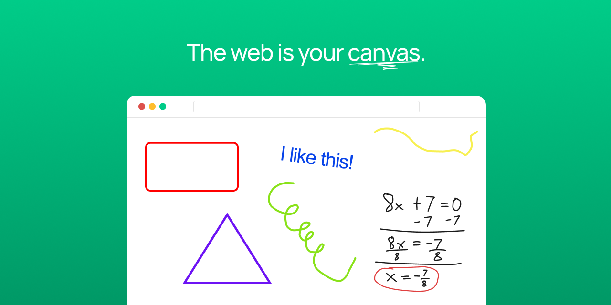

<div align="center">



#  Tracemark

A Chrome extension that lets you markup/annotate any webpage and export or copy the result as an image.

[](https://chromewebstore.google.com/detail/tracemark/mgckpdklnjeklihpmplgcfnhncifikjd)

[](https://chromewebstore.google.com/detail/tracemark/mgckpdklnjeklihpmplgcfnhncifikjd)
[](https://chromewebstore.google.com/detail/tracemark/mgckpdklnjeklihpmplgcfnhncifikjd)
[](https://chromewebstore.google.com/detail/tracemark/mgckpdklnjeklihpmplgcfnhncifikjd)
[](./LICENSE)

</div>

Tracemark injects a full-page drawing overlay into the active tab. Annotate anything — articles, dashboards, designs — with pencil, highlighter, text, and framing tools, then export the annotated view as a PNG or copy it straight to your clipboard.

## Features

- **Draw over any page** — pencil, highlighter, line, frame, text, eraser, and a color picker.
- **Edit as you go** — undo, redo, copy, paste, group, and delete your objects.
- **Capture in one click** — copy to clipboard or export as PNG.
- **Stays out of your way** — toolbar that snaps to any screen edge, single-key tool shortcuts, and a hotkey to hide the overlay without losing your work.
- **Light and dark themes** — follows your system by default; your choice is remembered across sites.
- **Private by design** — runs only on the tab you activate, entirely in your browser.
- **Onboards on install** — a welcome page walks through the tools and shortcuts.

## Controls

Click the toolbar icon to open the overlay on the current tab; click it again to close.

| Tool        | Key | What it does                           |
| ----------- | --- | -------------------------------------- |
| Interact    | `I` | Scroll and click the page underneath   |
| Select      | `V` | Move, resize, and group what you drew  |
| Pencil      | `P` | Freehand strokes, with size and color  |
| Highlighter | `H` | Translucent strokes to mark up text    |
| Erase       | `E` | Rub out parts of a stroke              |
| Text        | `T` | Drop a label anywhere on the page      |
| Frame       | `F` | Box off the part that matters          |
| Line        | `L` | Straight lines for pointing things out |

Pencil, Highlighter, Erase, Text, and Frame each open a popover for color, size, and style. Copy, Export (PNG), Clear, and the light/dark theme toggle live on the secondary toolbar.

<details>
<summary><strong>Keyboard shortcuts</strong></summary>
<br />

| Shortcut         | Action                   |
| ---------------- | ------------------------ |
| `⇧C`             | Copy canvas to clipboard |
| `⌘C` / `Ctrl+C`  | Copy selection           |
| `⌘V` / `Ctrl+V`  | Paste at cursor          |
| `⌘Z` / `Ctrl+Z`  | Undo                     |
| `⌘⇧Z` / `Ctrl+Y` | Redo                     |
| `⌘G` / `Ctrl+G`  | Group selection          |
| `Backspace`      | Delete selection         |
| `⌘.` / `Ctrl+.`  | Hide / show overlay      |

</details>

<details>
<summary><strong>Moving and hiding the toolbar</strong></summary>
<br />

Drag the toolbar by its handle to move it. It snaps to the nearest screen edge — horizontal on the top and bottom, vertical on the left and right — and collapses into a small circle while you pull it between edges.

Hiding the overlay with `⌘.` / `Ctrl+.` keeps your drawings, undo history, and active tool intact while the page works normally. Closing it does not — drawings aren't saved, so copy or export before closing the overlay or reloading the page.

</details>

## Tech Stack

- [WXT](https://wxt.dev) — extension framework and build tooling
- [React 19](https://react.dev) + TypeScript
- [Fabric.js 7](http://fabricjs.com) — canvas engine
- [Tailwind CSS 4](https://tailwindcss.com) + [shadcn/ui](https://ui.shadcn.com)
- [Motion](https://motion.dev) — animations

## Development

Requires [pnpm](https://pnpm.io) (see `packageManager` in `package.json`). This is a pnpm workspace — run everything from the repo root.

```bash
pnpm install
pnpm dev:extension   # launches a browser with the extension loaded and hot reload
```

| Script               | Description                                     |
| -------------------- | ----------------------------------------------- |
| `pnpm dev:extension` | Extension dev mode with hot reload              |
| `pnpm dev:web`       | Landing page dev server                         |
| `pnpm build`         | Production build of both apps                   |
| `pnpm zip`           | Package the extension as a distributable zip    |
| `pnpm check`         | Type-check the extension (`wxt prepare && tsc`) |
| `pnpm lint`          | Run ESLint in both apps                         |
| `pnpm checkall`      | Run `check`, `lint`, and `build` in sequence    |

Extension build output lands in `apps/extension/.output/`. To run any other script in a single app, use `pnpm --filter ./apps/<app> <script>`.

<details>
<summary><strong>Project structure</strong></summary>
<br />

```
apps/
├── extension/              # the Chrome extension (WXT + React)
│   └── src/
│       ├── entrypoints/    # background, overlay, and welcome entrypoints
│       ├── components/     # toolbar, canvas, color picker, popovers, ui
│       ├── context/        # fabric canvas, shadow DOM, theme, toolbar state
│       │   ├── fabric-canvas/
│       │   ├── shadow-dom/
│       │   ├── theme/      # light/dark theme, persisted to extension storage
│       │   └── toolbar/    # color, frame, pencil, highlighter, eraser, text
│       ├── lib/            # helpers + utils
│       ├── App.tsx
│       └── AppProviders.tsx
└── web/                    # the landing page (Next.js)
```

</details>

## License

See [LICENSE](./LICENSE).
